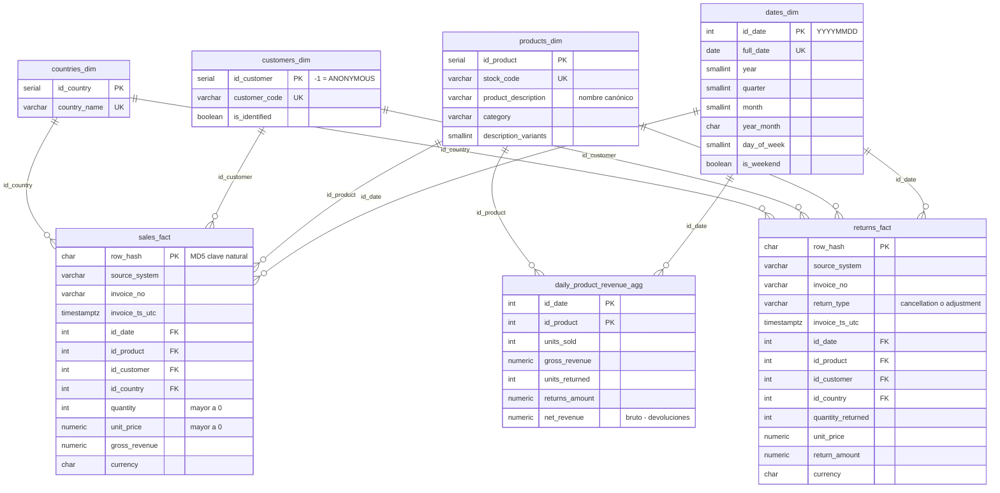

# Diagrama del modelo de datos

Esquema estrella en el esquema `dwh` del PostgreSQL analítico. GitHub dibuja el diagrama de abajo automáticamente. Para la versión en dbdiagram.io, importa [`modelo_datos.dbml`](modelo_datos.dbml). El DDL completo está en [`sql/ddl/`](../sql/ddl).

## Tablas de soporte (sin relaciones con el modelo estrella)

| Esquema | Tabla | Contenido |
|---|---|---|
| `staging` | `products_stg`, `sales_stg`, `returns_stg` | Tablas `UNLOGGED` de paso para el `COPY` masivo; se vacían en cada ejecución. |
| `audit` | `rejected_records` | Fila rechazada: fuente, número de fila en el CSV, motivo y registro original en `JSONB`. |
| `audit` | `pipeline_runs` | Bitácora por ejecución: filas leídas, válidas, rechazadas, duplicadas entre fuentes y estado. |
